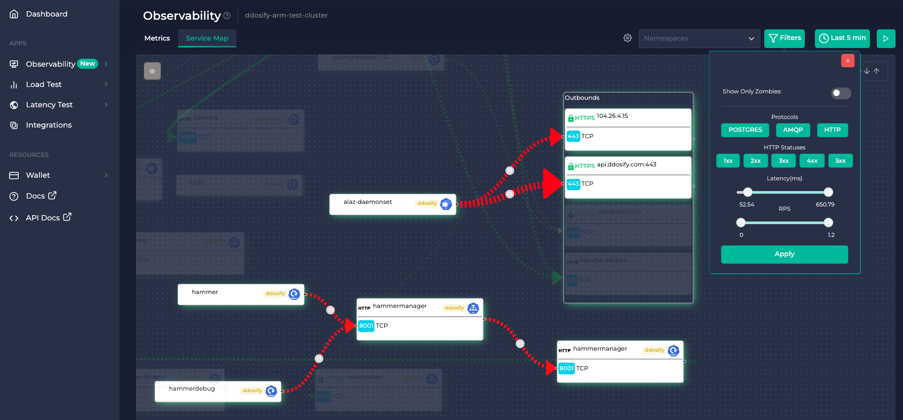

     
     

<h1 align="center">Anteon Self Hosted: Effortless Kubernetes Monitoring and Performance Testing</h1>

<i>Anteon detects high latency service calls on your K8s cluster. So you can easily find the root service causing the problem.</i>

## 📚 Documentation

- [🐝 Installing Anteon Self-Hosted](https://getanteon.com/docs/self-hosted/installation/)
- [⚙ Installing eBPF Agent (Alaz)](https://getanteon.com/docs/ebpf-agent-alaz/installation/)
- [📰 Upgrading to Self-Hosted Enterprise](https://getanteon.com/docs/self-hosted/upgrading-to-self-hosted-enterprise/)
- [📧 Slack Integration](https://getanteon.com/docs/self-hosted/self-hosted-slack-integration/)

See the [documentation](https://getanteon.com/docs/self-hosted/) for other guides such as [disabling telemetry](https://getanteon.com/docs/self-hosted/disabling-telemetry-data/).

## 📝 License

Anteon Self Hosted is licensed under the [AGPLv3](../LICENSE)
